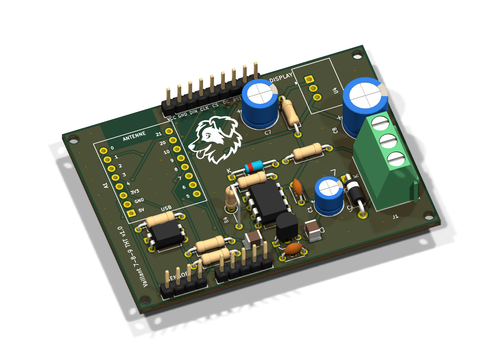
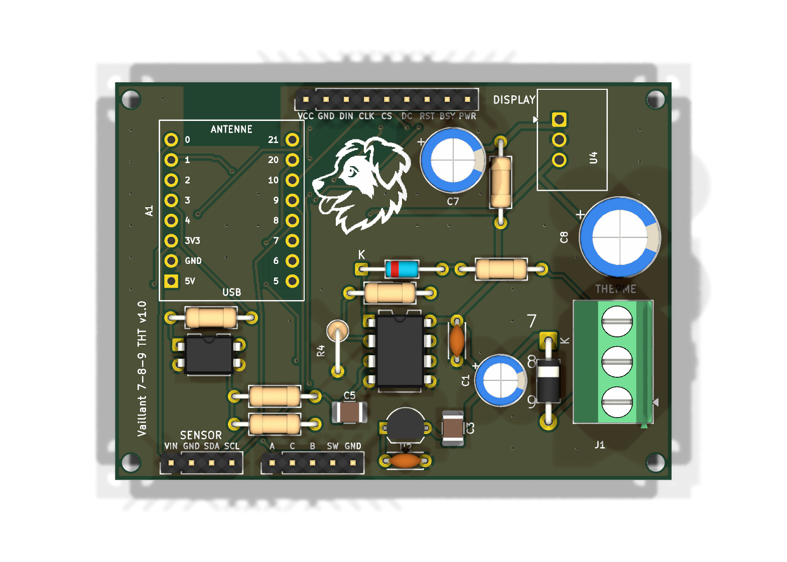
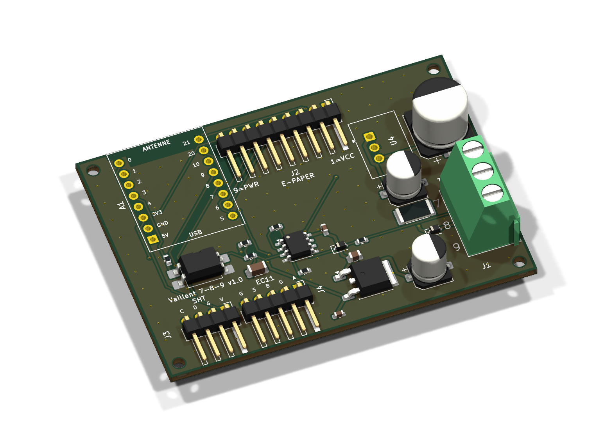
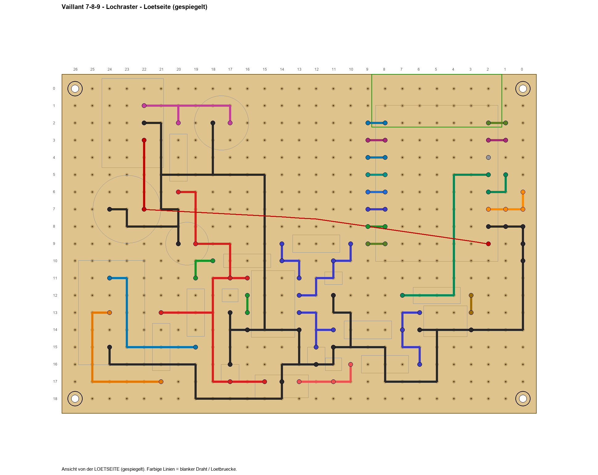
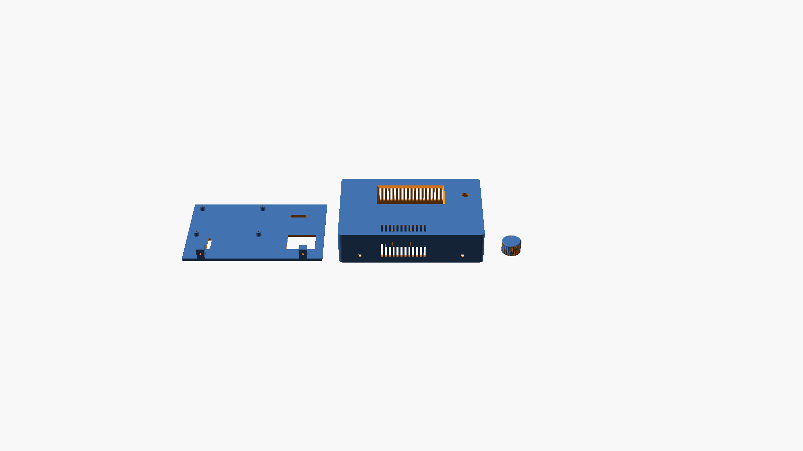

# Vaillant 7-8-9 WLAN-Thermostat (ESPHome / Home Assistant)

Ein selbst gebautes Wandthermostat für **Vaillant-Gasthermen ohne eBUS**. Es
ersetzt den alten Raumregler (hier einen **calorMATIC 332**) an seinem Platz an
der Wand. Die Therme wird stufenlos über die analoge **7-8-9-Schnittstelle**
gesteuert, eingebunden ist alles per **ESPHome in Home Assistant**.



*English summary:* A DIY room thermostat for Vaillant gas boilers with the analog
7-8-9 interface (no eBUS). An ESP32-C3 drives terminal 7 through an optocoupler,
RC filter and op-amp; supply comes from terminal 8. It has an e-paper display,
a rotary encoder and an SHT3x/SHT4x sensor, runs ESPHome with PID room control,
and integrates with Home Assistant. KiCad files, Gerbers, a perfboard layout,
3D-printable enclosure (OpenSCAD) and firmware are included. Documentation is in German.

> [!WARNING]
> **Nachbau auf eigene Gefahr.** Du arbeitest an einer Gasheizung. Die
> 7-8-9-Klemmen führen Kleinspannung (ca. 24 V), trotzdem gilt:
> - Die Therme vorher stromlos schalten.
> - Nur die Klemmen des Raumreglers anfassen.
> - Bei Unsicherheit eine Fachkraft fragen.
>
> Ein Fehler in der Steuerung kann die Heizung abschalten oder heißer laufen
> lassen. Der Drehknopf an der Therme bleibt in jedem Fall die obere Grenze.
> **Projektstand:** Schaltung, Platine und Firmware sind entworfen und
> geprüft (ERC/DRC fehlerfrei, Firmware-YAML syntaktisch geprüft), aber
> **noch nicht als fertiges Gerät im Betrieb getestet.** Erfahrungen und
> Korrekturen sind willkommen (Issues / Pull Requests).

---

## Inhalt

- [Wie funktioniert die 7-8-9-Schnittstelle?](#wie-funktioniert-die-7-8-9-schnittstelle)
- [Schaltung](#schaltung)
- [Funktionen der Firmware](#funktionen-der-firmware)
- [Drei Hardware-Varianten](#drei-hardware-varianten)
- [Teile](#teile)
- [Gehäuse (3D-Druck)](#gehäuse-3d-druck)
- [Aufbau und Inbetriebnahme](#aufbau-und-inbetriebnahme)
- [Kalibrierung](#kalibrierung)
- [Ordnerstruktur](#ordnerstruktur)
- [Offene Punkte](#offene-punkte)
- [Lizenz](#lizenz)

---

## Wie funktioniert die 7-8-9-Schnittstelle?

Ältere Vaillant-Thermen (hier eine **atmoTEC VCW 194/3-C-HL**) haben drei
Klemmen für einen stetigen Raumregler:

| Klemme | Bedeutung |
| --- | --- |
| **7** | Stellsignal: Spannung bestimmt die Vorlauf-Solltemperatur |
| **8** | Versorgung für den Regler (ca. 24 V) |
| **9** | Masse |

Der Regler **zieht Klemme 7 herunter**. Je niedriger die Spannung, desto
niedriger die Vorlauftemperatur. Unter etwa 10 V ist die Heizung aus. Die Therme
nimmt immer das **Minimum** aus Klemme 7 und ihrem eigenen Drehknopf, der Knopf
ist also eine harte Obergrenze.

An meiner Therme gemessen:

| Messung | Wert |
| --- | --- |
| Klemme 8 gegen 9 | 23,6 V (unter 24 mA Last kein relevanter Abfall) |
| Klemme 7 offen (kein Regler) | 22 V |
| Klemme 7, keine Wärmeanforderung | 10,1 V |
| Klemme 7, volle Anforderung | 17,8 V → 82 °C Vorlauf (Drehknopf voll auf) |

Andere Thermen können abweichen. Deshalb gibt es in der Firmware eine
[Kalibrierung](#kalibrierung).

## Schaltung

Schaltplan als PDF: [pcb-tht/fertigung/schaltplan.pdf](pcb-tht/fertigung/schaltplan.pdf)

```
VERSORGUNG (aus Klemme 8, Masse = Klemme 9 = ESP-GND)
  Kl.8 ─►|─ D1 1N5819 ─┬─ +V (ca. 23 V) ─ C1 100µF ─ GND
                       ├─ U2 78L09 ─ +9V  (C3 am Eingang, C4 100n am Ausgang)
                       └─ R7 100Ω ─┬─ C7 220µF ─ GND
                                   └─ U4 TRACO TSR 0.5-2450 ─┬─ C8 1000µF ─ GND
                                                             └─ ESP32-C3 SuperMini „5V“
STEUERUNG KLEMME 7 (fail-safe: ESP aus → Opto aus → +9 V am Tiefpass → Klemme 7 frei)
  GPIO3 ─ R1 330Ω ─ PC817 (Anode)            PC817 Kathode, Emitter ─ GND
  PC817 Kollektor ─ R2 10k ─ +9V
  PC817 Kollektor ─ R3 100k ─┬─ LM358 IN+
                             └─ C5 4,7µF X7R (kein Elko) ─ GND
  LM358 IN− ─ R4 100k ─ GND,  IN− ─ R5 120k ─ OUT   → Verstärkung 2,2
  Kl.7 ─ R6 220Ω ─►|─ LM358 OUT   (D2 1N4148, Kathode zum OPV)
```

- **PWM und Optokoppler:** Der ESP erzeugt ein PWM-Signal (500 Hz). Der
  Optokoppler zieht damit einen 9-V-Pegel taktweise auf Masse.
- **Glättung:** Der RC-Tiefpass macht daraus eine Gleichspannung von 0–9 V.
- **OPV:** Er verstärkt diese Spannung mit Faktor 2,2 auf 0–19,8 V und zieht
  Klemme 7 über die Diode auf diesen Wert herunter. Hochziehen kann er die
  Klemme nicht.
- **Fail-safe:** Fällt der ESP aus, sperrt der Optokoppler. Klemme 7 bleibt dann
  bei etwa 20 V, und die Therme heizt nach ihrem eigenen Drehknopf.
- **Arbeitsbereich:** 10,1–17,8 V an Klemme 7 entsprechen etwa 48–87 % PWM.
  Im Mittel braucht die Schaltung 12–15 mA aus Klemme 8.

**Peripherie (3,3 V vom ESP):**

| Teil | Anschlüsse |
| --- | --- |
| E-Paper Waveshare 2,9" V2 | DIN GPIO6, CLK GPIO4, CS GPIO7, DC GPIO5, RST GPIO10, BUSY GPIO1 |
| Sensor SHT31-D (oder SHT40) | SDA GPIO8, SCL GPIO9 |
| Drehgeber EC11 mit Taster | A GPIO21, B GPIO20, Taster GPIO0 |

## Funktionen der Firmware

Datei: [vaillant-789.yaml](vaillant-789.yaml) (ESPHome, ESP-IDF)

- **PID-Raumregelung:** In Home Assistant erscheint ein normales Thermostat.
  Der Wärmebedarf (0–100 %) wird auf einen einstellbaren Vorlaufbereich
  umgerechnet.
- **Betriebsarten:**
  - Aus
  - Raumregelung
  - Vorlauf manuell
  - Kalibrierung (PWM-Pegel direkt vorgeben)
- **Notbetrieb:** Fällt der Raumsensor aus, wird eine feste Vorlauftemperatur gefahren.
- **E-Paper-Anzeige:**
  - Raumtemperatur und Soll-Wert
  - Vorlauf-Soll und Wärmebedarf
  - Status und WLAN
- **Drehgeber:**
  - Drehen: Soll-Temperatur in 0,5-°C-Schritten
  - Drücken: Heizung ein/aus
- **Kalibrierung über Home Assistant:**
  - Spannung bei 50 % / 85 % PWM
  - Kennlinie Vorlauf ↔ Spannung (zwei Punkte)
  - Temperatur-Offset

Für eigene Zugangsdaten [secrets.example.yaml](secrets.example.yaml) nach
`secrets.yaml` kopieren und ausfüllen. Den Sensor-Typ (SHT31-D: `sht3xd`,
SHT40: `sht4x`) passt du in der YAML an.

## Drei Hardware-Varianten

Die Schaltung ist in allen drei Varianten gleich. Du kannst dir aussuchen, wie
du sie aufbaust.

| Variante | Ordner | Beschreibung |
| --- | --- | --- |
| **A – Platine zum Selbstlöten (empfohlen)** | [`pcb-tht/`](pcb-tht/) | Nur die Leiterplatte bei JLCPCB o. ä. fertigen lassen (Gerber-ZIP liegt bei). Alle Bauteile bedrahtet, nur zwei Kondensatoren als SMD 1210 mit Handlöt-Pads. |
| B – Platine mit SMD-Bestückung | [`pcb/`](pcb/) | Komplett bei JLCPCB bestückt (BOM/CPL im JLCPCB-Format). Bequemer, aber deutlich teurer. |
| C – Lochraster | [`lochraster/`](lochraster/) | 70 × 50 mm Lochrasterplatine mit Bestückungs- und Verdrahtungsplan. Ein Skript prüft alle Verbindungen. |

| THT-Platine (oben) | SMD-Variante | Lochraster (Lötseite) |
| --- | --- | --- |
|  |  |  |

**Zu allen Platinen:**
- **Format:** 70 × 50 mm, 2 Lagen.
- **Anschluss Therme:** Schraubklemme 7-8-9 am rechten Rand.
- **ESP:** Der ESP32-C3 SuperMini steckt in zwei Buchsenleisten, mit der Antenne nach oben über einer kupferfreien Zone.
- **Erzeugung:** Die KiCad-Projekte werden per Python-Skript aus einer
  gemeinsamen Netzliste erzeugt (`tools/design.py`), inklusive eines kleinen
  eigenen Autorouters. Du kannst die Dateien aber auch ganz normal in KiCad 10
  öffnen und bearbeiten.

## Teile

Alle Teile sind bei **Reichelt** erhältlich, der ESP32-C3 SuperMini zum
Beispiel bei Blinkyparts oder AliExpress. Stückliste mit Artikelnummern und
Links: [lochraster/README.md → Einkaufsliste](lochraster/README.md#einkaufsliste).
Für Variante A brauchst du die Lochrasterplatine und den Silberdraht daraus nicht.

Kosten (Stand Ende 2026): etwa 55 € bei Reichelt, davon rund 40 € für Display,
Sensor und Drehgeber. Dazu kommen ca. 5 € für den ESP und ein paar Euro für 5
Leiterplatten.

## Gehäuse (3D-Druck)



- **Modell:** Parametrisch in OpenSCAD:
  [vaillant-789-gehaeuse.scad](vaillant-789-gehaeuse.scad), 150 × 100 × 36 mm.
  Fertige STLs liegen in [`druck/`](druck/):
  - Rückplatte, wird an die Wand geschraubt (Langlöcher an den Positionen der alten calorMATIC-Halterung)
  - Frontgehäuse mit Displayfenster, belüfteter Sensorkammer und Lüftung oben
  - Drehknopf für die EC11-Achse (rund mit Schlitz oder D-Achse, umschaltbar)
- **Verschraubung:** ruthex-Gewindeeinsätze,
  M2 für die Platine und M3 für Front und Rückplatte. Die Maße sind oben in der
  `.scad` als Parameter einstellbar.
- **Material:** PETG oder ASA. PLA wird an der Wand in Heizungsnähe weich.
  Gute Werte sind 0,2 mm Schichthöhe, 3 Wände und 20 % Füllung.
- **Passform:** Die Platine ist mit den hohen Bauteilen gegen das Gehäuse
  geprüft ([Seitenansicht](druck/passform-seite.png)).
- **Maße:** Siehe [gehaeuse-massbild.png](gehaeuse-massbild.png). Wer eine
  andere Halterung hat, ändert `screw_ur` und `screw_ll` in der `.scad`.

## Aufbau und Inbetriebnahme

1. **Platine bestücken:** Die Hinweise zur Einbaurichtung stehen in
   [pcb-tht/README.md](pcb-tht/README.md) bzw. [lochraster/README.md](lochraster/README.md).
2. **Ohne Therme testen:** Etwa 24 V an Klemme 8/9 anlegen (Labornetzteil, Strom
   auf 100 mA begrenzen) und die Spannungen messen:
   - **+V:** ca. 23 V
   - **+9V:** 9 V
   - **5V am ESP:** 5 V
3. **ESP flashen:** `vaillant-789.yaml` im ESPHome Device Builder kompilieren
   und per USB flashen. Danach geht es auch per OTA.
4. **Ausgang prüfen, noch ohne Therme:** Klemme 7 über einen Widerstand von
   etwa 10 kΩ an 22 V hängen. In der Betriebsart „Pegel manuell“ die Spannung
   an Klemme 7 bei verschiedenen PWM-Pegeln messen.
5. **An die Therme anschließen:** Therme stromlos schalten, den alten Regler
   abklemmen und 7-8-9 an die Schraubklemme anschließen.

## Kalibrierung

Alle Werte stellst du in Home Assistant ein. Sie werden dauerhaft gespeichert.

1. **PWM-Kennlinie:** Betriebsart „Pegel manuell (Kalibrierung)“ wählen. PWM
   auf 50 % und auf 85 % stellen und jeweils die Spannung an Klemme 7 messen.
   Die Werte trägst du unter „Spannung bei Pegel 50 %/85 %“ ein.
2. **Vorlauf-Kennlinie:** Betriebsart „Vorlauf manuell“ wählen. Für einen
   niedrigen und einen hohen Vorlauf jeweils die Spannung und den Vorlauf an der
   Therme ablesen und als unteren und oberen Kennlinienpunkt eintragen.
3. **„Heizung aus“:** Die Spannung, bei der die Therme sicher aus ist, etwa
   0,5 V unter der gemessenen Schwelle.
4. **Temperatur-Offset:** Gleicht die Eigenerwärmung im Gehäuse aus. Dazu mit
   einem Referenzthermometer vergleichen.

## Ordnerstruktur

```
vaillant-789.yaml             ESPHome-Firmware
secrets.example.yaml          Vorlage für die Zugangsdaten
vaillant-789-gehaeuse.scad    Gehäuse (OpenSCAD)
druck/                        STL-Dateien und Ansichten
gehaeuse-massbild.png         Maßbild Gehäuse
pcb-tht/                      Variante A: KiCad-Projekt THT, Gerber, Renders, Generator-Skripte
pcb/                          Variante B: KiCad-Projekt SMD (JLCPCB-Bestückung), BOM/CPL
lochraster/                   Variante C: Lochraster-Layout, Verdrahtungsliste, Einkaufsliste
Einkaufsliste.md              Bestellliste für Variante B
```

## Offene Punkte

- **ESP-Reihenabstand:** Den Abstand der beiden Pinreihen des ESP32-C3
  SuperMini (15,24 mm angenommen) am eigenen Modul nachmessen. Es gibt Klone mit
  abweichendem Abstand.
- **Firmware:** Die YAML ist noch nicht kompiliert worden. Mögliche
  Stolperstellen sind `model: 2.90inv2` vs. `2.90inv2-r2` beim Display und
  `resolution` beim Drehgeber.
- **Kalibrierung:** Der untere Kennlinienpunkt (ca. 35 °C) muss am fertigen
  Gerät bestimmt werden.
- **Display-Höhe:** Den Abstand zwischen Display-Rückseite und dem höchsten
  Elko (ca. 4 mm) am echten Display prüfen.

## Lizenz

[MIT](LICENSE). Nutzung, Nachbau und Änderung sind ausdrücklich erwünscht. Die
KiCad-Bibliotheksteile unterliegen der KiCad-Bibliothekslizenz (CC-BY-SA 4.0
mit Ausnahme für erzeugte Platinen).
